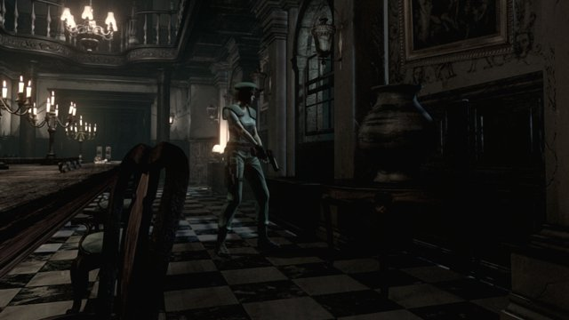
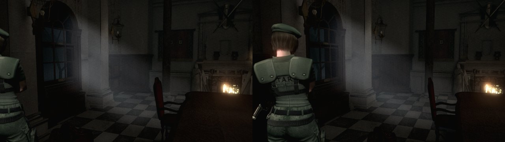
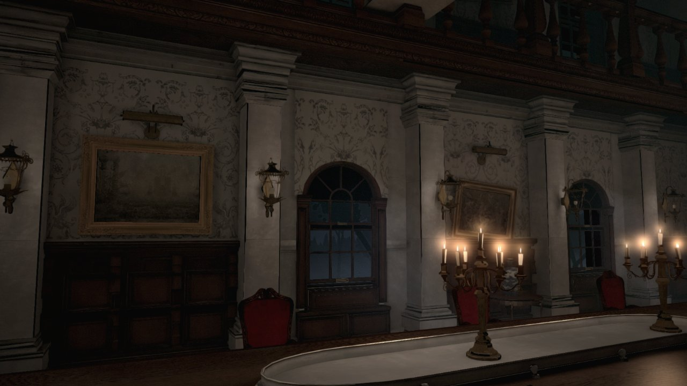
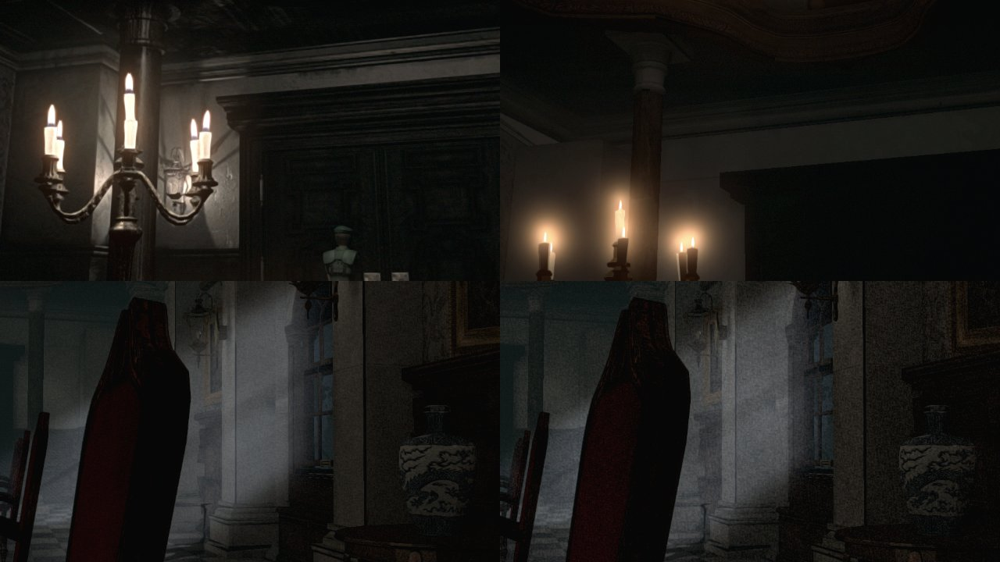
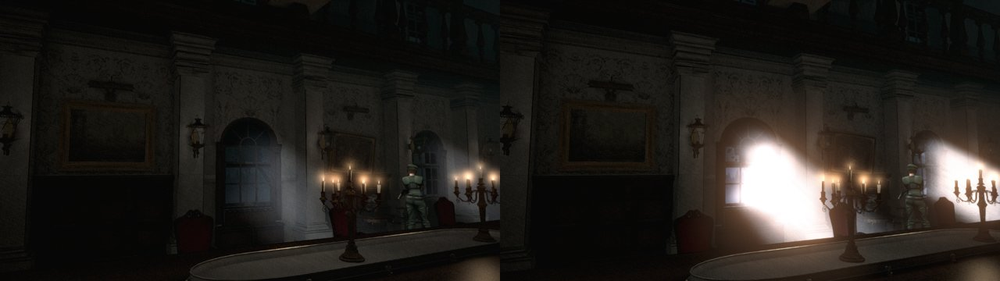
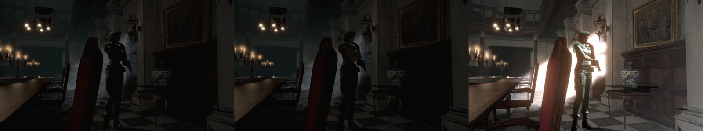

# Resident Evil HD Remaster – Definitive Third-Person Edition (Mod)

*[Leia em português](README.pt-BR.md)*

A mod for the PC version of **Resident Evil HD Remaster** (Steam, 2015) that replaces the fixed, pre-rendered camera angles with a **free third-person camera**. Each room is rebuilt as a real 3D scene, lit to match the original backgrounds, and drawn by the mod inside the game's own Direct3D 9 renderer.

> **Status: work in progress.** The first room being rebuilt is the **dining hall (room 105)**. See the [roadmap](ROADMAP.md).

## Gallery

| | |
|---|---|
| <br>**Free third-person camera** in the rebuilt dining hall | <br>**Moonbeam through the window** lighting the character |
| <br>**Room 105 rebuilt in 3D** with baked lighting | <br>**Candles and moonlight**, before / after grading |

**Thunder flash** – before / after:


**Character lit by the room** (ambient probe grid) – comparison:


## Progress at a glance

| Area | Done |
|---|---|
| **Third-person gameplay** | Free follow camera with right-stick orbit · camera kept out of walls · over-the-shoulder aim mode with reticle · character turns to face the aim · player found in memory automatically · works with controller and keyboard |
| **3D modelling (room 105)** | Full dining hall rebuilt and checked against the game's backgrounds and depth maps · pilasters, cornices, niches, ceiling, wall panels, doors, fireplace, furniture and props · window landscape · z-fighting and hidden-geometry checker |
| **Lighting & effects** | Lightmaps baked in Blender/Cycles in 4 animated layers · clean lightmap UV (no black lines on corners) · volumetric moonbeams · thunder flash · emissive bloom, halos, grain, colour grading · character lit by an 800-probe grid |

Full list: [ROADMAP.md](ROADMAP.md).

## What it does

- **Free third-person camera** that follows Jill/Chris, orbits with the right stick, and has an over-the-shoulder aim mode with a reticle.
- **3D room instead of the pre-rendered picture**: the mod draws a rebuilt room mesh in place of the background, using the game's own textures loaded from your installation.
- **Baked lighting (lightmaps)** made in Blender/Cycles with bounced light and soft shadows, split into 4 animated layers (main light, fireplace, candles, wall sconces) so flames flicker.
- **Atmosphere effects**: volumetric moonlight beams through the windows, emissive-only bloom, light halos, film grain, colour grading, and a thunder flash.
- **The character is lit by the room**: an 800-probe grid gives Jill the room's ambient light and the moonbeam.
- **Live tuning** without restarting: almost every value can be changed while playing through `ctl.txt`.
- **Model checker** (`ext/verificador.py`): finds z-fighting, hidden faces and lightmap faces that are too thin, and renders them from the game cameras before any bake.

## How it works

| Part | File | Role |
|---|---|---|
| Loader | `d3d9proxy/d3d9.c` | `d3d9.dll` proxy placed next to the game; loads the mod |
| Mod | `mod/mod.c` | Hooks Direct3D 9, draws the room, camera, shaders, effects |
| Pipeline | `ext/*.py` | Blender/Python scripts: rebuild, lightmap UV, bake, export |
| Notes | `NOTES.md`, `PLANO_R105.md` | Research notes and the room 105 plan (Portuguese) |

**Room formats** written by the pipeline and read by the mod:
- `RMS2`: position + UV.
- `RMS3`: adds baked per-vertex light.
- `RMS4`: adds a second lightmap UV and the lightmap layer PNGs.

## Building

Requirements: Windows, [LLVM-MinGW](https://github.com/mstorsjo/llvm-mingw) (32-bit `i686` target), PowerShell.

```powershell
./build.ps1           # builds mod/re1mod.dll and asks a running game to reload it
./build.ps1 -Loader   # also builds the d3d9.dll loader and copies it to the game folder
```

The asset pipeline needs **Blender 5.2** (Cycles; an NVIDIA GPU with OptiX is strongly recommended) and Python 3 with `numpy` and `Pillow`.

> Paths are still hard-coded for the author's machine (`%USERPROFILE%\Tools\...`). Making them configurable is on the roadmap.

## Legal

This repository contains **only original code and documentation**. It does **not** include any game files, textures, models, backgrounds or other Capcom assets. You need your own legal copy of Resident Evil HD Remaster. Resident Evil is a trademark of Capcom. This is a fan project, not affiliated with or endorsed by Capcom.

## Contributing

Issues and pull requests are welcome. Everyone who helps is listed in the [Hall of Fame](CONTRIBUTORS.md).
