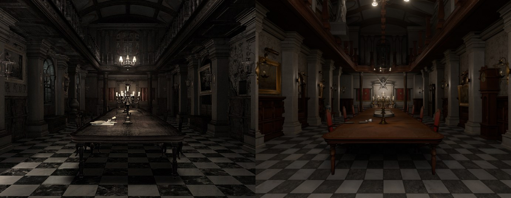
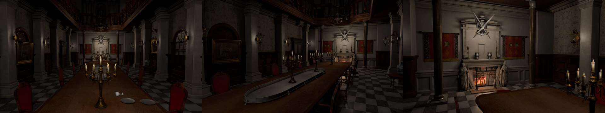
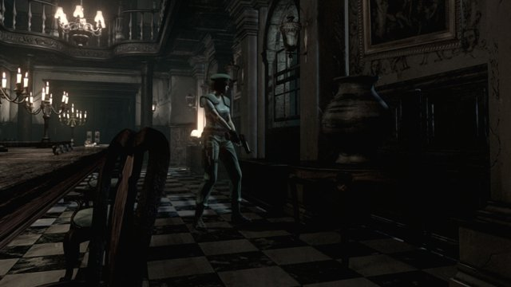
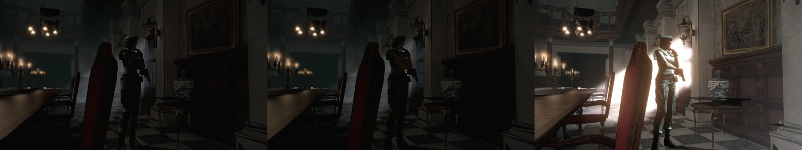

# Resident Evil HD Remaster – Definitive Third-Person Edition (Mod)

*[Read in English](README.md)*

Mod para a versão de PC do **Resident Evil HD Remaster** (Steam, 2015) que troca as câmeras fixas e os cenários pré-renderizados por uma **câmera livre em terceira pessoa**. Cada sala é reconstruída como cena 3D de verdade, iluminada para parecer com os fundos originais, e desenhada pelo mod dentro do próprio renderizador Direct3D 9 do jogo.

> **Situação: em desenvolvimento.** A primeira sala reconstruída é a **sala de jantar (sala 105)**. Veja o [mapa do projeto](ROADMAP.pt-BR.md).

## Galeria

**Fundo pré-renderizado original (esquerda) x nossa reconstrução 3D (direita), mesma câmera** – render da sala reconstruída no Blender:


**A mesma sala de ângulos que o jogo original nunca mostrou** – renders no Blender:


**No jogo, com o mod:**

| | |
|---|---|
| <br>Câmera livre em terceira pessoa na sala reconstruída | <br>Feixe de luar pela janela iluminando a Jill |


A Jill recebendo a luz da sala (grade de sondas), no jogo.

## Progresso

Estimativas, atualizadas à mão.

| Área | Progresso | |
|---|---|---|
| **Salas reconstruídas** | `█░░░░░░░░░░░░░░░░░░░` | **1** de mais de 100 (sala de jantar) |
| Sala 105 – modelagem 3D | `███████████████████░` 95% | sala inteira, conferida com os fundos do jogo |
| Sala 105 – iluminação | `████████████░░░░░░░░` 60% | lightmaps prontos; faltam relâmpago/luar nas janelas e ajuste por câmera |
| **Gameplay em terceira pessoa** | `████████████░░░░░░░░` 60% | 6 de 10 mecânicas |
| Efeitos | `█████████████████░░░` 85% | falta só a sombra da personagem |
| Ferramentas e pipeline | `█████████████░░░░░░░` 65% | faltam pacote de release e caminhos configuráveis |

**Mecânicas de terceira pessoa**

| Mecânica | |
|---|---|
| Câmera livre que segue, giro no analógico direito | ✅ |
| Câmera não atravessa paredes | ✅ |
| Mira por cima do ombro com retícula | ✅ |
| Personagem vira para onde mira | ✅ |
| Personagem achada na memória sozinha | ✅ |
| Controle e teclado | ✅ |
| Câmera passando por portas / troca de sala | ⬜ |
| Cenas e eventos roteirizados | ⬜ |
| Mirar nos inimigos (travar alvo) | ⬜ |
| Testado com o Chris | ⬜ |

Lista completa: [ROADMAP.pt-BR.md](ROADMAP.pt-BR.md).

## O que faz

- **Câmera livre em terceira pessoa**: segue a Jill/Chris, gira com o analógico direito e tem modo de mira por cima do ombro, com retícula.
- **Sala em 3D no lugar da imagem pré-renderizada**: o mod desenha a sala reconstruída no lugar do fundo, usando as texturas do próprio jogo, lidas da sua instalação.
- **Luz assada (lightmap)** no Blender/Cycles, com luz rebatida e sombras suaves, em 4 camadas animadas (luz geral, lareira, velas, arandelas), para as chamas tremularem.
- **Clima**: feixes volumétricos de luar pelas janelas, bloom só nas fontes de luz, halos, granulado, correção de cor e clarão de trovão.
- **A personagem recebe a luz da sala**: uma grade de 800 sondas dá à Jill a luz ambiente e o feixe de luar.
- **Ajuste ao vivo** sem reiniciar: quase tudo se muda com o jogo aberto, pelo `ctl.txt`.
- **Verificador do modelo** (`ext/verificador.py`): acha z-fighting, faces escondidas e faces finas demais para o lightmap, e renderiza nas câmeras do jogo antes de qualquer bake.

## Como funciona

| Parte | Arquivo | Função |
|---|---|---|
| Carregador | `d3d9proxy/d3d9.c` | `d3d9.dll` falso ao lado do jogo; carrega o mod |
| Mod | `mod/mod.c` | Intercepta o Direct3D 9, desenha a sala, câmera, shaders e efeitos |
| Pipeline | `ext/*.py` | Scripts Blender/Python: reconstrução, UV do lightmap, bake, export |
| Notas | `NOTES.md`, `PLANO_R105.md` | Anotações de pesquisa e o plano da sala 105 |

## Compilar

Requisitos: Windows, [LLVM-MinGW](https://github.com/mstorsjo/llvm-mingw) (alvo 32 bits `i686`), PowerShell.

```powershell
./build.ps1           # compila mod/re1mod.dll e pede para o jogo aberto recarregar
./build.ps1 -Loader   # também compila o carregador d3d9.dll e copia para a pasta do jogo
```

O pipeline de cenário precisa do **Blender 5.2** (Cycles; placa NVIDIA com OptiX é muito recomendada) e Python 3 com `numpy` e `Pillow`.

> Os caminhos ainda estão fixos para a máquina do autor (`%USERPROFILE%\Tools\...`). Deixar configurável está no mapa.

## Aviso legal

Este repositório contém **apenas código e documentação originais**. **Não** inclui arquivos do jogo, texturas, modelos, fundos ou qualquer outro material da Capcom. É preciso ter uma cópia legal do Resident Evil HD Remaster. Resident Evil é marca da Capcom. Projeto de fã, sem ligação com a Capcom nem aprovação dela.

## Contribuir

Issues e pull requests são bem-vindos. Quem ajudar entra no [Hall da Fama](CONTRIBUTORS.md).
